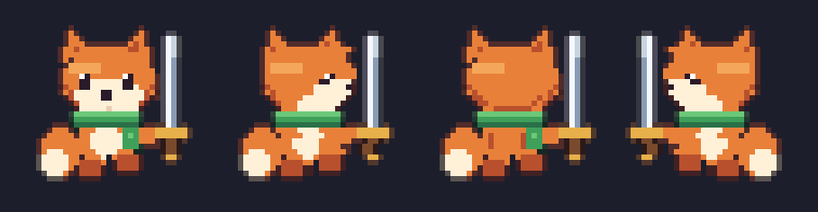
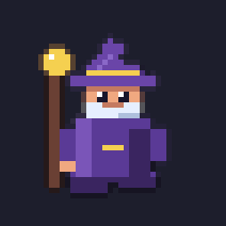
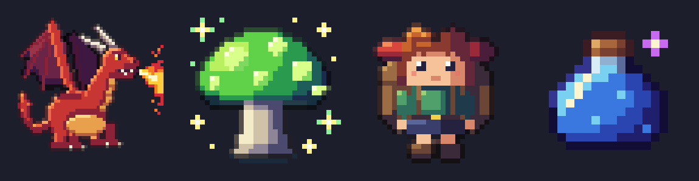
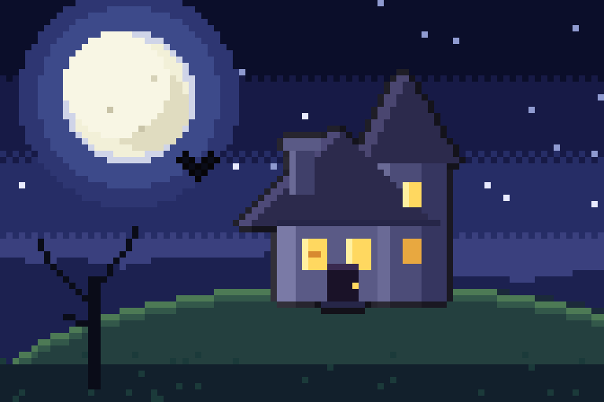
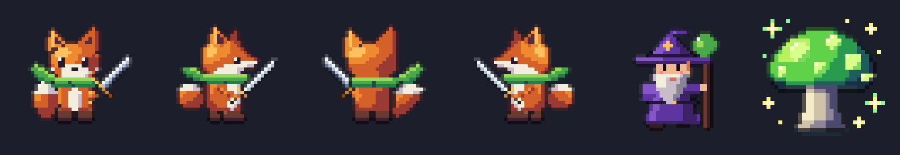
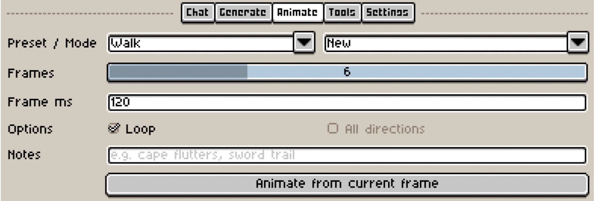
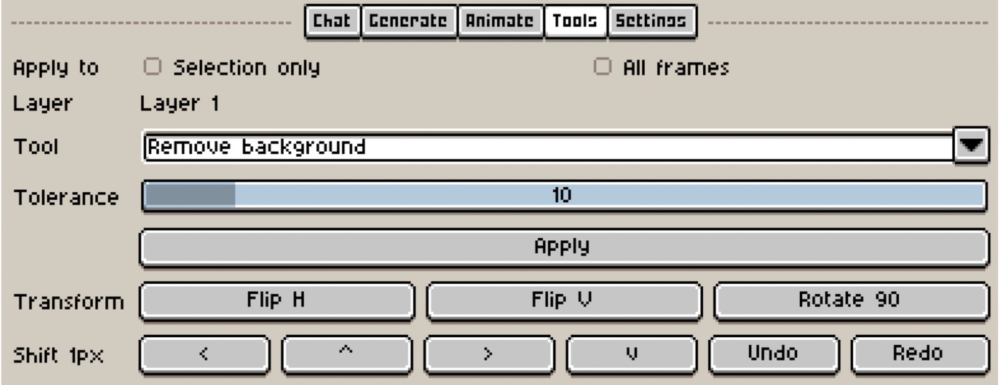
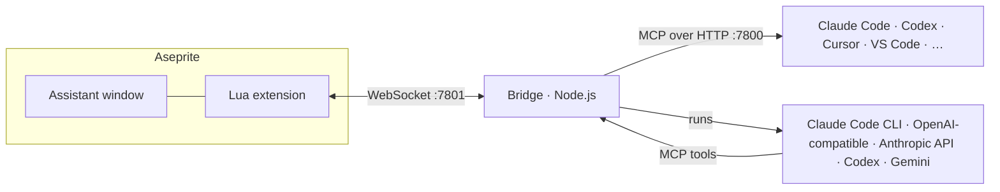

<div align="center">

# Aseprite MCP

**An AI pixel-art assistant that draws, edits and animates right inside [Aseprite](https://www.aseprite.org/).**

Type what you want in a window inside Aseprite and watch it appear as real pixels, on real layers
and frames, one Ctrl+Z away. Or connect any [MCP](https://modelcontextprotocol.io) client
(Claude Code, Codex, Cursor, VS Code, Gemini CLI, …) to the same 34 tools.

[](https://github.com/HaktanSaglam/aseprite-mcp/actions/workflows/ci.yml)
[](LICENSE)


<sub>A real run: one Generate click, Claude Opus, under a minute, a 32×32 sprite on its own layer.</sub>

[Gallery](#gallery) · [Features](#features) · [Install](#install) · [Workflows](#workflows) ·
[Tools](#tools) · [How it works](#how-it-works) · [Roadmap](#roadmap) · [License](#license)

</div>

> **Actively developed.** This is the first public release and new features land regularly —
> see the [roadmap](#roadmap) and the [changelog](CHANGELOG.md). Ideas and bug reports are very
> welcome in [Issues](https://github.com/HaktanSaglam/aseprite-mcp/issues).

## Why

AI image generators paint blurry "pixel-style" pictures: no real grid, hundreds of colors, no
layers, no frames. Pixel art needs exact pixels, small palettes, clean outlines and editable
layers and frames.

Aseprite MCP gives a language model **hands inside Aseprite** instead. It looks at your canvas,
plans with pixel-art rules (hue-shifted ramps, one light direction, clean 1 px lines, no pillow
shading), draws with precise tools, checks the result and fixes what reads badly. Everything it
makes is ordinary Aseprite content you keep editing — and every AI edit is a single undo step.

## Gallery

Everything below was drawn inside Aseprite by Claude (mostly Opus) through this extension: no image
model, no post-processing, just layers and frames.

<table>
<tr>
<td align="center" width="62%">
<br>
<sub><b>Directions from your art + Animate all directions.</b> A 32×32 fox drawn from one prompt,
turned into 4 facings (the left side is mirrored from the right), then walking in all four.</sub>
</td>
<td align="center" width="38%">
<br>
<sub><b>Style reference + Animate.</b> The wizard was asked to match the fox's style, then
given a walk cycle.</sub>
</td>
</tr>
</table>

<p align="center">
  <br>
  <sub><i>"a small red dragon breathing fire, side view"</i> (48×48) · <i>"a glowing magical green mushroom
  with bright spots and floating sparkles"</i> (32×32) · <i>"a girl adventurer with a big backpack"</i> (32×32) ·
  <i>"a blue mana potion icon"</i> (16×16)</sub>
</p>

<table>
<tr>
<td align="center"><br>
<sub><i>"a spooky haunted house on a hill at night with a full moon"</i> — 96×64, one request</sub></td>
<td align="center"><br>
<sub><i>"a cozy wooden cabin in a pine forest at dusk"</i> — 128×80, 16-bit style</sub></td>
</tr>
</table>

<p align="center">
  <br>
  <sub><b>Batch:</b> <i>"iron sword; wooden shield; red health potion; golden key; magic staff; treasure chest"</i> —
  six 16×16 sprites drawn in parallel, each in its own tab, from one shared palette.</sub>
</p>

<p align="center">
  <br>
  <sub>The fox turned into four facings, a wizard drawn with the fox as style reference, and a
  glowing mushroom.</sub>
</p>

<p align="center">
  
  
</p>

## Features

**Draw**
- **Text → sprite** at any size, in a style (NES, SNES, Game Boy, PICO-8, 1-bit, HD) and palette
  (11 presets, your sprite's palette, or your own `#rrggbb` list).
- **Many at once**: 2–4 variations or a whole batch drawn in parallel, each in its own tab.
- **4 or 8 directions** — from a prompt, or **from the sprite you already drew**: your frame stays
  exactly as it is, the model draws the other facings from it, left sides are mirrored from the
  right ones and then touched up.
- **Style reference**: new art matches the palette, outlines and proportions of another open sprite.
- **Seamless tiles**: the tile view checks the art repeated 3×3 and fixes the seams.

**Animate**
- Presets for idle, walk, run, jump, attack, hurt and death (or describe your own), with frame
  count, timing, loop and tags.
- **All directions at once**: the down view first, then every other facing matched to it
  (`walk_down`, `walk_right`, …).
- **In-betweens** between two key frames, or **continue** an animation from the frames you keep.

**Edit and clean up**
- **Redraw a selection**: select an area, describe the change, only those pixels change.
- **Review & fix**: the model scores its work (`analyze_sprite` returns 0–100 and the concrete
  problems: stray pixels, outline gaps, doubled corners, banding, pillow shading, too many colors)
  and fixes them.
- **Import PNG + Normalize (unzoom)**: bring in upscaled or AI-generated "pixel art" and snap it
  back to its real pixel grid and a clean palette.
- **Instant tools without AI**: remove background, outline, reduce colors, apply a palette,
  hue/saturation/lightness, cleanup, drop shadow, flip/rotate/shift.
- **Color rules**: a color limit (4–32) or a forced palette, enforced after the run in one undo step.

**Stay in control**
- **Undo AI run**: everything the last run changed on your sprite, back in one click (only offered
  when you didn't touch the sprite meanwhile).
- **Repeat last**, settings remembered per sprite, Stop at any time.
- **Pick power vs. speed**: model (Fable, Opus, Sonnet, Haiku, or another provider) and effort
  (Fast, Balanced, Smart, Max). The window shows each run's time, steps and cost.
- **Fast**: pixels travel as raw bytes (a 256×256 canvas round-trips in milliseconds), and shapes are
  drawn by small sandboxed scripts instead of pixel lists. A sprite takes 10–30 seconds with Sonnet,
  about a minute with Opus.
- **Safe by design**: everything listens on `127.0.0.1` only, scripts run in a QuickJS sandbox, and
  the assistant's model gets only the Aseprite tools — no shell, no file browsing.

## Install

You need [Aseprite](https://www.aseprite.org/) 1.3 or newer, [Node.js](https://nodejs.org/) 20 or
newer, and for the built-in assistant the [Claude Code CLI](https://claude.com/claude-code) signed in
with your Claude account (`claude auth login`). The assistant runs on your own Claude plan.

### Option A — from the release (no Git needed)

1. Download `aseprite-mcp.aseprite-extension` and `aseprite-mcp-bridge-x.y.z.tgz` from the
   [latest release](https://github.com/HaktanSaglam/aseprite-mcp/releases/latest).
2. Install the bridge and start it (keep this terminal open):
   ```bash
   npm install --global ./aseprite-mcp-bridge-1.0.0.tgz
   aseprite-mcp
   ```
3. Double-click `aseprite-mcp.aseprite-extension` (or in Aseprite: **Edit › Preferences ›
   Extensions › Add Extension**) and restart Aseprite.

### Option B — from source

```bash
git clone https://github.com/HaktanSaglam/aseprite-mcp.git
cd aseprite-mcp
./scripts/install.sh
```

On Windows: `powershell -ExecutionPolicy Bypass -File scripts\install.ps1`.

The installer builds the bridge, packages the extension and hands it to Aseprite, and offers to
register the MCP server with Claude Code and to start the bridge automatically at login
(`--service`). Without the service, start it yourself: `cd bridge && npm start`.

### First run

1. In Aseprite open **Edit › FX › Aseprite MCP › AI Assistant…**
2. Aseprite asks once whether the extension may open a connection: tick **Don't show this specific
   alert again for this script** and click **Allow to Open Connections**.
3. The dot at the top of the window turns green: type *"a 32x32 slime with a shiny highlight"* and
   press Enter.

The first PNG or GIF export asks the same way for write access (**Allow Write Access**).
Something not working? `aseprite-mcp doctor` (or `node bridge/bin/aseprite-mcp.js doctor`) checks
every piece and says what to fix; see also [Troubleshooting](docs/TROUBLESHOOTING.md).

## Using the assistant

| Tab | What it does |
|---|---|
| **Chat** | Talk to the model. Model and effort, your selection as the area to change, one-click *Redraw selection*, *Review & fix*, *Variations*, *Repeat last* and *Undo AI run*. |
| **Generate** | Text → sprite: size, style, palette and color limit, view (front, side, ¾, top-down, isometric, seamless tile), target (new sprite / new layer / active layer), outline, variations, batches and 4/8 directions — from your prompt or the current sprite, optionally matching a reference sprite. |
| **Animate** | Preset, frame count, frame duration, loop; new, in-betweens or continue; all directions at once. |
| **Tools** | Instant edits without AI on the active layer, all frames or just the selection, including *Normalize (unzoom)* and *Import PNG*. |
| **Settings** | AI provider, model, effort, auto-review, bridge port. |

<p align="center">
  
  
</p>

## Workflows

**1. A sprite from a sentence.** *Generate* tab → type *"an open treasure chest overflowing with gold
coins"* → pick 32×32 → **Generate**. A new tab opens, zoomed to fit, with the sprite on its own layer.
Not quite right? Say so in *Chat* (*"make the coins brighter"*) — the model sees the canvas and edits it.

**2. Your character, walking in every direction.** Draw (or generate) your character facing down →
*Generate* tab, **Source: Current sprite** → **4 directions**. You get a new sprite with `down`,
`right`, `up`, `left` frames, your drawing untouched as frame 1. Then *Animate* → **Walk**, tick **All
directions** → the fox at the top of this page is exactly this.

**3. Fix one part.** Select the area with any selection tool → *Chat* → *"give him a red cape"* →
**Send** (or **Redraw selection**). Only the selected pixels change; the rest stays yours.

**4. A matching item set.** *Generate* → Palette **ENDESGA 32**, size 16×16 → Batch: *"sword; shield;
potion; key"* → **Generate batch**. Each item is drawn in parallel in its own tab, all from the same
palette.

**5. Clean up an AI image.** *Tools* → Tool **Import PNG** → pick an upscaled or AI-made image →
**Apply**, then Tool **Normalize (unzoom)** → **Apply**. It detects the real pixel size (e.g. 8×),
snaps every block to one color, limits the palette, and tells you the exact crop for the new size.

**6. Limit the colors.** *Generate* → Palette **PICO-8**, **Force palette**, Colors **Max 6** → any
prompt. After the run the bridge snaps the layers it drew to those rules in one undo step.

Didn't like a run? **Undo AI run** puts the sprite back exactly as it was.

## Use it from other AI tools

The bridge is a standard MCP server at `http://127.0.0.1:7800/mcp` (Streamable HTTP):

```bash
claude mcp add --transport http --scope user aseprite http://127.0.0.1:7800/mcp
```

Then just ask, e.g. *"draw a 32x32 potion icon in Aseprite and animate it bubbling"*. See
[docs/CLIENTS.md](docs/CLIENTS.md) for Codex, Cursor, VS Code, Claude Desktop, Gemini CLI, Windsurf
and Zed, or run `aseprite-mcp print-config <client>`.

## Tools

34 MCP tools, each with a description written for a model:

| Area | Tools |
|---|---|
| Sprite | `get_sprite_info` `create_sprite` `list_sprites` `select_sprite` `edit_sprite` `undo` `redo` `save_sprite` `export_sprite` |
| Pixels & drawing | `read_pixels` `write_pixels` `view_sprite` `draw_script` `pixel_art_guide` |
| Structure | `manage_layers` `manage_frames` `manage_tags` `get_selection` `set_selection` |
| Color | `get_palette` `set_palette` `get_palette_preset` `apply_palette` `reduce_colors` `replace_color` `adjust_colors` |
| Effects | `add_outline` `remove_background` `cleanup_pixels` `transform_layer` `drop_shadow` `normalize_pixel_art` `analyze_sprite` |
| Import | `import_image` |

**Pixel grids.** `read_pixels` and `write_pixels` use a compact palette grid, one character per pixel:

```json
{ "palette": { "o": "#1a1c2c", "r": "#b13e53" }, "rows": [".oo.", "orro", ".oo."] }
```

**Drawing scripts.** `draw_script` runs a short JavaScript program in a sandbox with pixel-exact
primitives (lines, shapes, polygons, flood fill, dithering), pixel-art helpers (hue-shifted color
ramps, banded sphere shading, outlines, mirroring, a tiny pixel font) and an animation mode that runs
the script once per frame — thousands of pixels in one call, returned with a preview.

**Knowledge base.** `pixel_art_guide` holds pixel-art rules for characters, animation, tiles, items,
environments, shading, palettes, outlines and styles; the assistant inlines the relevant topic into
every request.

## How it works



- **aseprite-extension/** — a thin Lua extension: moves raw pixels, calls Aseprite's API and hosts
  the assistant window.
- **bridge/** — a TypeScript server: the MCP tools, all pixel algorithms (compositing, selection
  masks, effects, palettes, quality checks), the chat orchestration and the AI providers. 900+ tests.
- **docs/PROTOCOL.md** — the contract between the two.

## AI providers

The in-Aseprite assistant is built and tested around **Claude Code**: it runs `claude -p` with your
own Claude plan, keeps a warm process per conversation for fast follow-ups, and sees a preview of
your canvas with every request.

| Provider | How it connects | Status |
|---|---|---|
| Claude Code | `claude -p` with your Claude plan | default, recommended |
| OpenAI-compatible | API key / base URL (OpenAI, OpenRouter, Ollama, LM Studio, …) | experimental |
| Anthropic API | `ANTHROPIC_API_KEY` | experimental |
| Codex CLI | `codex exec` with your ChatGPT login | experimental |
| Gemini CLI | `gemini` with your Google login | experimental |

Configure them in `~/.aseprite-mcp/config.json` — see [bridge/src/llm/README.md](bridge/src/llm/README.md).

## Configuration

| Env var | Default | |
|---|---|---|
| `ASEPRITE_MCP_PORT` | `7800` | MCP HTTP port |
| `ASEPRITE_WS_PORT` | `7801` | Aseprite WebSocket port |
| `ASEPRITE_REQUEST_TIMEOUT_MS` | `30000` | per Aseprite call |
| `ASEPRITE_MAX_PARALLEL` | `4` | parallel model runs (variations, batches) |
| `ASEPRITE_MCP_CONFIG` | `~/.aseprite-mcp/config.json` | provider settings |
| `CLAUDE_PATH` | `claude` | Claude Code CLI |
| `ASEPRITE_CLAUDE_WORKDIR` | `~/.aseprite-mcp/work/claude` | empty folder the CLI runs in |

## Roadmap

Aseprite MCP is under active development. Being worked on or explored next:

- **Tilesets**: Wang/autotile sets and tilemap layers, not just single seamless tiles.
- **More providers, tested**: first-class OpenAI, Gemini and local models (Ollama) next to Claude.
- **Better animation**: smoother walk and run cycles, effects (smears, particles), onion-skin aware edits.
- **Skeleton-guided poses** and character sheets.
- **History**: browse and reapply earlier generations per sprite.

Have an idea? [Open an issue](https://github.com/HaktanSaglam/aseprite-mcp/issues) — feedback
decides what comes next.

## Troubleshooting

See [docs/TROUBLESHOOTING.md](docs/TROUBLESHOOTING.md), or run `aseprite-mcp doctor`.

## Development

```bash
cd bridge
npm ci
npm run typecheck && npm test
npm run dev                     # bridge with auto-reload
../scripts/dev-install-extension.sh   # copy the extension into Aseprite, then restart Aseprite
```

Lua tests run headless in Aseprite:

```bash
aseprite -b --script-param root="$PWD/aseprite-extension" --script aseprite-extension/tests/rpc_test.lua
```

See [CONTRIBUTING.md](CONTRIBUTING.md) and [SECURITY.md](SECURITY.md).

## License

Aseprite MCP is **source-available** under the [PolyForm Noncommercial License 1.0.0](LICENSE).

- ✅ Free to use, study, modify and share for **personal, hobby, educational, research and other
  noncommercial** purposes.
- ❌ **Commercial use is not allowed** — including selling it, bundling it into a paid product or
  offering it as a paid service — without a separate commercial license.

Want to use it commercially? Contact [@HaktanSaglam](https://github.com/HaktanSaglam) through an
[issue](https://github.com/HaktanSaglam/aseprite-mcp/issues) for a commercial license.

Copyright © 2026 Haktan Saglam. Aseprite is a trademark of Igara Studio; this project is not affiliated
with or endorsed by Igara Studio or Anthropic.
