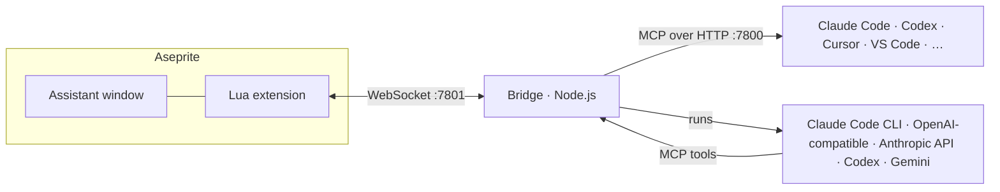

<div align="center">

# Aseprite MCP

**An AI pixel-art assistant that draws, edits and animates directly inside [Aseprite](https://www.aseprite.org/).**

Chat with it in a window inside Aseprite, or connect any [MCP](https://modelcontextprotocol.io) client
(Claude Code, Codex, Cursor, VS Code, Gemini CLI, …) to the same toolset.

[](https://github.com/HaktanSaglam/aseprite-mcp/actions/workflows/ci.yml)
[](LICENSE)


</div>

## Why

AI image generators paint blurry "pixel-style" pictures. Pixel art needs exact pixels, small
palettes, clean outlines and real layers and frames you can keep editing. Aseprite MCP gives a
language model hands inside Aseprite instead: it reads your canvas, draws on its own layer, builds
animation frames and tags, and every change is one Ctrl+Z away.

## Features

- **Text → sprite** in a chosen size, style (NES, SNES, Game Boy, PICO-8, 1-bit, HD) and palette.
- **Edit what you select**: redraw or inpaint a selection so it blends into the art around it.
- **Animate**: idle, walk, run, jump, attack, hurt, death or custom, with frame timings and tags.
- **Many at once**: 2–4 variations or a whole batch ("sword; shield; potion") drawn in parallel,
  each in its own tab; a character in 4 or 8 directions.
- **Review & fix**: the model looks at its work, measures it (`analyze_sprite`) and cleans up
  stray pixels, broken outlines and muddy colors.
- **Instant tools, no AI needed**: remove background, outline, reduce colors, apply a palette,
  hue/saturation/lightness, cleanup, drop shadow, flip/rotate/shift.
- **Pick power vs. speed**: model (Fable, Opus, Sonnet, Haiku, or another provider) and effort
  (Fast, Balanced, Smart, Max) right in the chat tab.
- **Bring your own AI**: runs on your Claude subscription through Claude Code by default;
  OpenAI-compatible APIs (OpenAI, OpenRouter, Ollama, LM Studio), the Anthropic API, Codex CLI and
  Gemini CLI are supported experimentally.
- **Fast**: pixels travel as raw image bytes (a 256×256 canvas round-trips in milliseconds), the
  model gets the canvas state and a preview up front, and big structures are drawn by small sandboxed
  scripts instead of pixel lists.
- **Safe by design**: everything listens on `127.0.0.1` only, scripts run in a QuickJS sandbox,
  every AI edit is a single undo step.

## How it works



- **aseprite-extension/** — a thin Lua extension: moves raw pixels and calls Aseprite's API, and
  hosts the assistant window.
- **bridge/** — a TypeScript server: the MCP tools, all pixel algorithms (compositing, selection
  masks, effects, palettes), the chat orchestration and the AI providers.
- **docs/PROTOCOL.md** — the contract between the two.

## Quick start

Requirements: [Aseprite](https://www.aseprite.org/) 1.3 or newer, [Node.js](https://nodejs.org/) 20
or newer, and for the built-in chat the [Claude Code CLI](https://claude.com/claude-code) logged in
with your account (`claude auth login`).

```bash
git clone https://github.com/HaktanSaglam/aseprite-mcp.git
cd aseprite-mcp
./scripts/install.sh            # Windows: powershell -File scripts/install.ps1
```

The installer builds the bridge, packages the extension and opens it in Aseprite, and can register
the MCP server with Claude Code. Then start the bridge (or install it as a background service with
`./scripts/install.sh --service`):

```bash
cd bridge && npm start
```

In Aseprite open **Edit › FX › Aseprite MCP › AI Assistant…**. The first time, Aseprite asks whether
the extension may open a connection: tick **Don't show this specific alert again for this script**
and click **Allow to Open Connections**.

## Using the assistant

| Tab | What it does |
|---|---|
| **Chat** | Talk to the model. Pick model and effort, use your selection as the area to change, one-click *Redraw selection*, *Review & fix* and *Variations*. |
| **Generate** | Text → sprite with size, style, palette, view (front, side, ¾, top-down, isometric), target (new sprite / new layer / active layer), outline, variations, batches and 4/8 directions. |
| **Animate** | Turn the current sprite into an animation: preset, frame count, frame duration, loop. |
| **Tools** | Instant edits without AI on the active layer, all frames or just the selection. |
| **Settings** | AI provider, model, effort, auto-review, bridge port. |

Every AI edit lands on its own layer by default and is a single undo step.

## Use it from other AI tools

The bridge is a standard MCP server at `http://127.0.0.1:7800/mcp` (Streamable HTTP):

```bash
claude mcp add --transport http --scope user aseprite http://127.0.0.1:7800/mcp
```

See [docs/CLIENTS.md](docs/CLIENTS.md) for Codex, Cursor, VS Code, Claude Desktop, Gemini CLI and
others, or run `npx aseprite-mcp print-config <client>`.

## Tools

| Area | Tools |
|---|---|
| Sprite | `get_sprite_info` `create_sprite` `list_sprites` `select_sprite` `edit_sprite` `undo` `redo` `save_sprite` `export_sprite` |
| Pixels & drawing | `read_pixels` `write_pixels` `view_sprite` `draw_script` `pixel_art_guide` |
| Structure | `manage_layers` `manage_frames` `manage_tags` `get_selection` `set_selection` |
| Color | `get_palette` `set_palette` `get_palette_preset` `apply_palette` `reduce_colors` `replace_color` `adjust_colors` |
| Effects | `add_outline` `remove_background` `cleanup_pixels` `transform_layer` `drop_shadow` `analyze_sprite` |

### Pixel grids

`read_pixels` and `write_pixels` use a compact palette grid, one character per pixel:

```json
{ "palette": { "o": "#1a1c2c", "r": "#b13e53" }, "rows": [".oo.", "orro", ".oo."] }
```

### Drawing scripts

`draw_script` runs a short JavaScript program in a sandbox with pixel-exact primitives (lines,
shapes, polygons, flood fill, dithering), pixel-art helpers (hue-shifted color ramps, banded sphere
shading, outlines, mirroring, a tiny pixel font) and an animation mode that runs the script once
per frame.

## AI providers

| Provider | How it connects | Status |
|---|---|---|
| Claude Code | `claude -p` with your Claude subscription | default |
| OpenAI-compatible | API key / base URL (OpenAI, OpenRouter, Ollama, LM Studio, …) | experimental |
| Anthropic API | `ANTHROPIC_API_KEY` | experimental |
| Codex CLI | `codex exec` with your ChatGPT login | experimental |
| Gemini CLI | `gemini` with your Google login | experimental |

Configure them in `~/.aseprite-mcp/config.json` — see [bridge/src/llm/README.md](bridge/src/llm/README.md).

## Configuration

| Env var | Default | |
|---|---|---|
| `ASEPRITE_MCP_PORT` | `7800` | MCP HTTP port |
| `ASEPRITE_WS_PORT` | `7801` | Aseprite WebSocket port |
| `ASEPRITE_REQUEST_TIMEOUT_MS` | `30000` | per Aseprite call |
| `ASEPRITE_MAX_PARALLEL` | `4` | parallel model runs (variations, batches) |
| `ASEPRITE_MCP_CONFIG` | `~/.aseprite-mcp/config.json` | provider settings |
| `CLAUDE_PATH` | `claude` | Claude Code CLI |

## Troubleshooting

See [docs/TROUBLESHOOTING.md](docs/TROUBLESHOOTING.md).

## Development

```bash
cd bridge
npm ci
npm run typecheck && npm test
npm run dev                     # bridge with auto-reload
../scripts/dev-install-extension.sh   # copy the extension into Aseprite, then restart Aseprite
```

Lua tests run headless in Aseprite:

```bash
aseprite -b --script-param root="$PWD/aseprite-extension" --script aseprite-extension/tests/rpc_test.lua
```

See [CONTRIBUTING.md](CONTRIBUTING.md).

## License

[MIT](LICENSE) © Haktan Saglam
